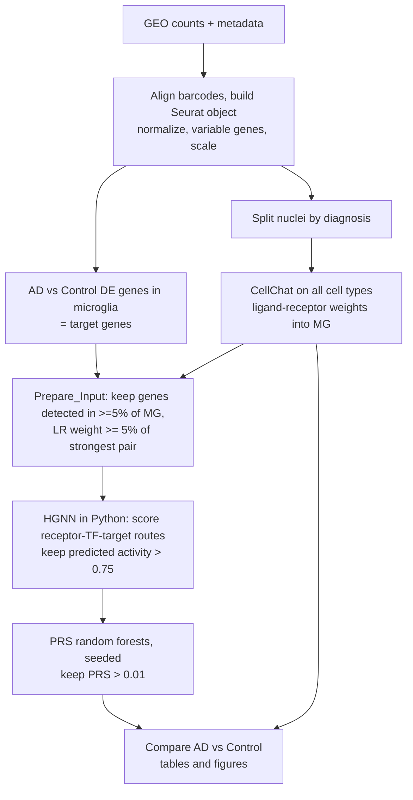
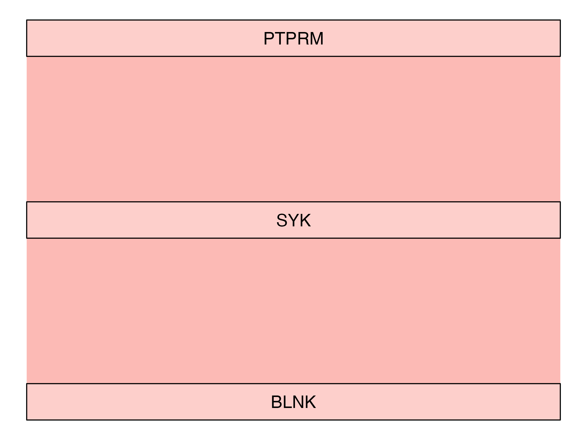
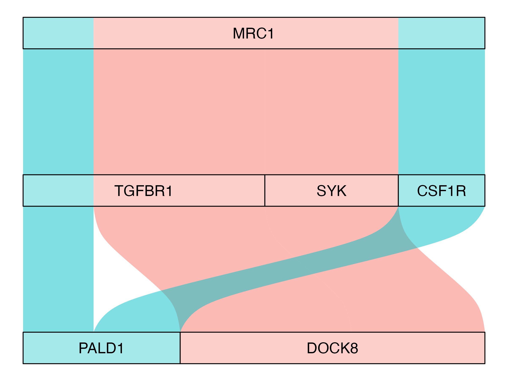

# Receptor-to-target crosstalk in Alzheimer's microglia (SigXTalk on GSE174367)

Course project, *Scientific Programming* (Maastricht University). The focus of the project is the **analysis
pipeline**: how signals sent by all brain cell types are traced through receptors and transcription factors to the
genes that change in microglia in Alzheimer's disease (AD).

## 1. Research question

> Which receptor → intermediate → target-gene signaling routes in **microglia** differ between AD and control
> brains, and how does the cell-cell communication that reaches microglia differ between the two groups?

The pipeline uses **SigXTalk** (Nature Communications 2025, <https://doi.org/10.1038/s41467-025-61149-7>):
CellChat infers ligand-receptor communication between all cell types, a hypergraph neural network (HGNN) scores
which receptor → transcription-factor → target routes are likely active, and random forests (PRS, *pathway
regulatory strength*) quantify and filter the surviving routes.

## 2. Data

Single-nucleus RNA-seq of human prefrontal cortex, Morabito et al. 2021 (*Nature Genetics*), GEO accession
[GSE174367](https://www.ncbi.nlm.nih.gov/geo/query/acc.cgi?acc=GSE174367). After joining the count matrix to the
authors' annotation, 61,472 nuclei are used (**all of them; there is no downsampling**).

| Cell type | Control | AD |
|---|---:|---:|
| ODC (oligodendrocytes) | 14,993 | 22,059 |
| EX (excitatory neurons) | 1,644 | 4,725 |
| INH (inhibitory neurons) | 1,806 | 4,156 |
| ASC (astrocytes) | 1,760 | 2,996 |
| **MG (microglia, receiver cell type)** | **1,384** | **2,742** |
| OPC | 1,038 | 1,702 |
| PER.END (pericytes/endothelial) | 171 | 296 |
| **Total** | **22,796** | **38,676** |

The 274 MB count matrix is larger than GitHub's 100 MB file limit and is therefore **not** stored here.
`data/README.md` explains where to download it. The small metadata file is included.

## 3. Method and why each step is there



| Step | Why this approach |
|---|---|
| Use the authors' cell-type labels | They are published and validated; re-clustering would add variability unrelated to the question |
| Target genes = AD-vs-Control DE genes **within microglia** | Ties the signaling analysis to disease biology instead of generic marker genes |
| CellChat on *all* cell types | Microglia receive signals from every other cell type; the sender side must be complete |
| HGNN | SigXTalk's model for which candidate receptor-TF-target routes are plausible given the expression data |
| Seeded random forests (PRS) | Gives a quantitative strength per route; the seeding fixes a reproducibility gap in the original function |
| No downsampling | Earlier runs capped each cell type at 1,500 cells to fit in memory. The cap changes which cells inform the model, so the final run uses every nucleus |
| Same targets and thresholds in both groups | Keeps the AD-vs-Control comparison fair |

The full reasoning, with the code, is in `analysis/01_sigxtalk_pipeline.Rmd`.

### Tools and versions used at each step

All versions are those of the reported run (taken from `results/sessionInfo_full_run.txt`) unless marked otherwise.

| Step | Tool | Version |
|---|---|---|
| Read the 10x HDF5 counts | `Seurat::Read10X_h5` (needs `hdf5r`) | Seurat 5.6.0, SeuratObject 5.4.0, hdf5r 1.3.16 |
| Normalize, variable genes, scale, DE (Wilcoxon) | Seurat; `presto` speeds up the Wilcoxon test | Seurat 5.6.0, presto 1.1.0 |
| Cell-cell communication | CellChat (`SigXTalkR::Infer_CCI` calls it) | CellChat 2.2.0.9001 |
| Prepare input, prior networks, PRS filter | SigXTalkR | SigXTalkR 0.1.0 |
| Call Python from R | `SigXTalkR::Run_py_script` through `reticulate` | reticulate 1.47.0 |
| Hypergraph neural network | `hgnn/main.py` with the Python module `SigXTalkpy` in conda environment `SigXTalk_py` | Python 3.8.x and PyTorch 1.13.1, as required by SigXTalk; see section 6 |
| PRS random forests | `ranger`, run in parallel with `snow` + `doSNOW` + `foreach` | ranger 0.18.0, snow 0.4-4, doSNOW 1.0.20, foreach 1.5.2 |
| Model workflow used inside PRS | `tidymodels`, `parsnip` | tidymodels 1.5.0, parsnip 1.6.1 |
| Tables and figures | dplyr, tidyr, ggplot2, patchwork, ggalluvial, ComplexHeatmap, igraph | dplyr 1.2.1, tidyr 1.3.2, ggplot2 4.0.3, patchwork 1.3.2, ggalluvial 0.12.6, ComplexHeatmap 2.28.0, igraph 2.3.4 |
| Run everything | R on Apple Silicon | R 4.6.1, macOS Tahoe 26.6.2 (aarch64-apple-darwin23) |

## 4. Repository structure

```
.
├── README.md
├── LICENSE                           # MIT license of the code in this repository
├── analysis/
│   ├── 01_sigxtalk_pipeline.Rmd      # the complete pipeline (R Markdown)
│   └── 02_de_direction_check.Rmd     # direction of change of the genes in the final pathways
├── hgnn/
│   ├── main.py                       # HGNN training script (Python, from SigXTalk)
│   └── NOTICE.md                     # origin, license, what was changed
├── data/
│   ├── README.md                     # how to obtain the raw data
│   └── GSE174367_snRNA-seq_cell_meta.csv
├── environment/
│   ├── install_r_packages.R          # R packages
│   └── python_environment.md         # conda environment for the HGNN
├── results/                          # generated output, kept apart from data and code
│   ├── README.md                     # guide to every file
│   ├── tables/
│   ├── figures/GSE174367_{Control,AD}_full/
│   ├── hgnn_outputs/
│   └── sessionInfo_full_run.txt      # exact R and package versions of the reported run
├── docs/
│   └── project_notes.md              # challenges, mistakes and what was learned
└── work/                             # created at run time (checkpoints), git-ignored
```

## 5. How to run

1. **Install the software** (section 6): R packages with `environment/install_r_packages.R`, and the conda
   environment `SigXTalk_py` described in `environment/python_environment.md`.
2. **Download the data** into `data/` (see `data/README.md`). The metadata file is already there.
3. **Knit** `analysis/01_sigxtalk_pipeline.Rmd`. In RStudio press *Knit*; from R:
   ```r
   setwd("analysis")
   rmarkdown::render("01_sigxtalk_pipeline.Rmd")
   ```
   Nothing needs to be typed during the run. Intermediate results are saved in `work/`, so an interrupted run
   continues from the last finished step when knitted again (delete `work/*.rds` to force a full recompute).
4. Optionally knit `analysis/02_de_direction_check.Rmd` after step 3 (needs `results/tables/results_*_full.csv`).

Figures and tables are written to `results/` (the files that come with the repository are the ones reported here).

**Resources.** This is a heavy run: CellChat is applied to every nucleus of each group (about 22,800 control and
38,700 AD nuclei). It was run on a laptop with R's macOS vector-memory cap lifted (`RAISE_R_MEMORY_CAP`), so
16 GB of RAM or more is advisable, and the run takes a long time. Quit other applications before starting.

## 6. Software requirements and environment set-up

The pipeline is R (analysis) plus Python (the neural network). R starts the Python script, so both must be installed.

### 6.1 R

* **R 4.6.1** was used for the reported run, on Apple Silicon (macOS Tahoe 26.6.2). SigXTalk itself states a minimum of
  **R >= 4.1.1**; only 4.6.1 was tested here.
* **R packages and versions** of the reported run:

  | Package | Version | Package | Version |
  |---|---|---|---|
  | Seurat | 5.6.0 | ggplot2 | 4.0.3 |
  | SeuratObject | 5.4.0 | patchwork | 1.3.2 |
  | CellChat | 2.2.0.9001 | ggalluvial | 0.12.6 |
  | SigXTalkR | 0.1.0 | ComplexHeatmap | 2.28.0 |
  | dplyr | 1.2.1 | igraph | 2.3.4 |
  | tidyr | 1.3.2 | hdf5r | 1.3.16 |
  | foreach | 1.5.2 | ranger | 0.18.0 |
  | doSNOW | 1.0.20 | snow | 0.4-4 |
  | tidymodels | 1.5.0 | parsnip | 1.6.1 |
  | reticulate | 1.47.0 | presto | 1.1.0 |
  | Biobase | 2.72.0 | BiocGenerics | 0.58.1 |
  | BiocNeighbors | 2.6.0 | Matrix | 1.7-6 |

  The complete list (every attached and loaded package) is in `results/sessionInfo_full_run.txt`.
* `rmarkdown`, `knitr` and `pandoc` (included with RStudio) are needed to knit. Their versions were not recorded in
  `sessionInfo`, because they were not loaded in the R session that ran the analysis.
* **Install:** run `environment/install_r_packages.R`. It installs the CRAN and Bioconductor packages, then CellChat
  (`devtools::install_github("jinworks/CellChat")`) and SigXTalkR
  (`devtools::install_github("LithiumHou/SigXTalk", dependencies = TRUE, upgrade = "always")`). The two GitHub packages
  have no release tags, so they install the newest development version; the stored run used CellChat 2.2.0.9001 and
  SigXTalkR 0.1.0.

### 6.2 Python (conda environment `SigXTalk_py`)

SigXTalk's own instructions (<https://github.com/LithiumHou/SigXTalk>) require **Python 3.8.x** and **PyTorch 1.13.1**.
The environment is set up with these commands (macOS; on Linux/Windows use the PyTorch CPU or CUDA wheel given in the
SigXTalk instructions, see `environment/python_environment.md`):

```bash
conda create -n SigXTalk_py python=3.8
conda activate SigXTalk_py

pip install torch==1.13.1           # macOS; CPU only, Apple Silicon has no CUDA
pip install pandas numpy            # imported directly by hgnn/main.py
pip install git+https://github.com/LithiumHou/SigXTalk.git#subdirectory=pythoncodes   # the SigXTalkpy module
```

The environment name matters: the pipeline calls `Run_py_script("main.py", conda_env = "SigXTalk_py", ...)`, so R finds
Python through this name. The HGNN is trained on the CPU (`--device cpu`) with seed 42.

The exact versions of `pandas`, `numpy` and `SigXTalkpy` that were installed on the machine that produced the results were
not saved at the time. To record them, run on that machine:

```bash
conda activate SigXTalk_py
python --version
conda env export -n SigXTalk_py > environment/sigxtalk_py_full.yml
pip freeze > environment/sigxtalk_py_requirements.txt
```

and commit the two files (see `environment/python_environment.md`).

## 7. Results in brief

All numbers below come from the tables in `results/tables/`.

| | Control | AD |
|---|---:|---:|
| Candidate receptor-TF-target links given to the HGNN | 699 | 1,404 |
| Routes predicted active by the HGNN (activity > 0.75) | 11 | 58 |
| Routes after the PRS filter (PRS > 0.01) | 7 | 52 |
| Receptors that survive | 1 (PTPRM) | 2 (MRC1, PTPRM) |
| Target genes explained | 5 | 14 |
| Distinct intermediate → target links | 7 | 28 |

* **Control** has one receptor. Its strongest route is PTPRM → SYK → BLNK (weight 0.33).
* **AD** has two receptors, and its strongest routes start at MRC1 and pass through TGFBR1, SYK and CSF1R to
  DOCK8 and PALD1.
* **Shared targets:** ESR1, FMN1, NRP1, THRB. **Control only:** BLNK. **AD only:** ADAM28, CD163L1, CSF1R, DOCK8,
  MCTP1, PALD1, PCSK5, PLXNC1, RBM47, TGFBR1.
* **Missing heatmaps for Control are expected.** The receptor-target heatmap and the receptor-by-intermediate
  heatmap need at least two receptors, and Control retains only one.
* **Cell-cell communication** is lower in AD overall. The largest drops are between excitatory neurons, OPCs and
  inhibitory neurons (for example EX → EX 10.1 in Control and 8.1 in AD), not into microglia.
* **Direction of change** (`results/tables/pathway_genes_DE_direction_MG.csv`): the targets DOCK8, ADAM28, PALD1
  and BLNK are lower in AD microglia, whereas MCTP1, PLXNC1, FMN1, CD163L1, PCSK5 and NRP1 are higher. The
  receptors MRC1 and PTPRM and the intermediate SYK are not significantly changed.

<p>


</p>

*Alluvial plots read top to bottom: receptor → intermediate → target gene. Left: Control. Right: AD.*

## 8. Limitations and how to read the results

* **Small gene universe.** SigXTalk can only use genes in the scaled matrix. Only about 2,000 variable genes were
  scaled, and after the 5% expression filter 444 genes remained for Control microglia. Strong microglial and AD genes
  such as APP, SORL1, SPP1 and ITGB2 are therefore not available as ligands or receptors. This, more than any
  threshold, is why only one or two receptors survive. Scaling more genes is the most important next step.
* **The routes are statistical associations**, from expression co-variation. They are not demonstrated signaling,
  and the weights are unsigned (they do not say activation or repression).
* **The counts of routes are not a measure of signaling strength.** The count is capped by the number of surviving
  receptors, and AD has twice as many microglia (2,742 vs 1,384), which favors detecting more links.
* **Statistics:** the DE p-values treat every nucleus as independent. There is no donor-level replication.
* **Known issue.** In a later spot check, the Control CellChat checkpoint did not reproduce the APP → SORL1 and
  APP → CD74 rows listed in `results/tables/LR_pairs_into_MG_AD_vs_Control.csv`. Treat the Control side of that
  one table as provisional until it is re-derived (see `docs/project_notes.md`).

## 9. Reproducibility

* Random forests: `PRS_calc_seeded()` fixes the seed of every parallel worker (`PRS_SEED = 42`).
* HGNN: seed 42 is set for Python, NumPy and PyTorch in `hgnn/main.py`; it runs on the CPU.
* Every analysis parameter is stated in the R Markdown file: 5% expression filter, ligand-receptor weight at
  least 5% of the strongest pair, HGNN activity above 0.75, PRS threshold 0.01, DE rule (`min.pct = 0.1`,
  |log2FC| > 0.25, adjusted p < 0.05).
* File paths are relative to the repository root, so no personal paths are needed.

## 10. References

* Morabito S. et al. Single-nucleus chromatin accessibility and transcriptomic characterization of Alzheimer's
  disease. *Nature Genetics* 53, 1143-1155 (2021). GEO: GSE174367.
* SigXTalk: *Dissecting crosstalk induced by cell-cell communication using single-cell transcriptomic data*,
  *Nature Communications* (2025). <https://github.com/LithiumHou/SigXTalk> (MIT license).
* Jin S. et al. CellChat: inference and analysis of cell-cell communication. *Nature Communications* 12, 1088 (2021).
* Hao Y. et al. Dictionary learning for integrative, multimodal and scalable single-cell analysis. *Nature Biotechnology* 42, 293-304 (2024) (Seurat v5).

## 11. License

* **Code and documentation written for this project** (the R Markdown files, README and notes) are released under the
  **MIT License** (see `LICENSE`, Copyright (c) 2026 Ahmed). This applies to the files outside `hgnn/` and to the
  figures and tables in `results/`.
* **Third-party code.** `hgnn/main.py` is the HGNN training script from SigXTalk, and `PRS_calc_seeded()` in the R
  Markdown file is a copy of SigXTalk's `PRS_calc()` with one line added (see section 9). SigXTalk
  (<https://github.com/LithiumHou/SigXTalk>, Copyright (c) 2025 Jiawen Hou) is also released under the MIT License.
  These parts remain under that license; `hgnn/NOTICE.md` gives the details. The packages listed in section 6 are installed
  separately and keep their own licenses.
* **Data.** The GSE174367 count matrix is **not** redistributed here. The cell metadata file in `data/` comes from the
  same GEO record, belongs to the original authors (Morabito et al. 2021) and is included only so that the analysis can
  be re-run; please cite the paper if you reuse it.

## Author

Ahmed (anmsuya1@gmail.com)
